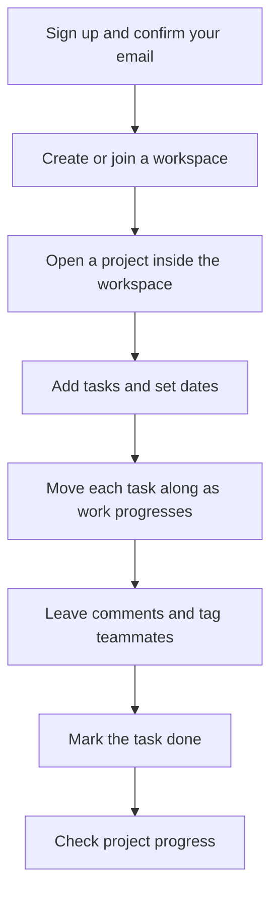
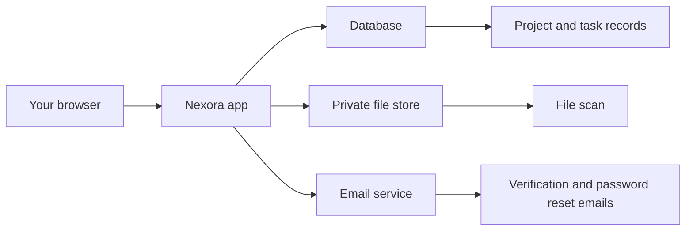
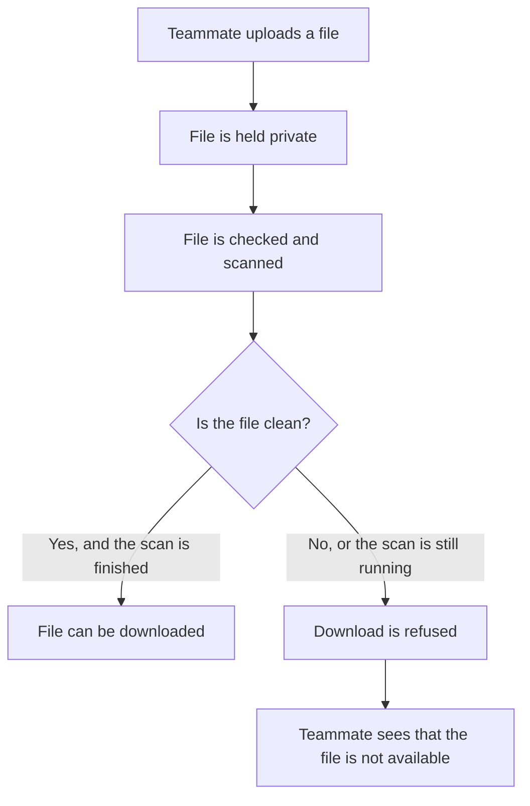

# Nexora

Nexora is a web app where a team plans work together, in one place.
You open it in a browser. There is nothing to install.

It is live at https://nexora-two-ruby.vercel.app.

## What Nexora is

A team uses Nexora to keep its work visible. Work is split into small jobs, and everyone can see who is doing what and what is still open.
A workspace is the shared space for one team. Inside a workspace, a project is one piece of work. A milestone is a checkpoint inside a project, with a date attached. A task is a single job inside a project.

## Who uses it

Teams that need to plan work together use it. One person sets up the workspace, and teammates join it. Each person works on their own tasks and can see the tasks of others in the same workspace.

## What you can do in it

Teams create workspaces, projects, milestones, and tasks. A task can have a date, a person assigned to it, and notes about what needs to happen.
Tasks can be viewed two ways. Kanban view shows tasks on a board, in columns that show how far along each task is. List view shows the same tasks in rows, one after another.
Teammates can leave comments on a task. A mention tags a teammate by name, so that person knows the comment is for them. An activity record lists recent changes, so the team can see what moved and who changed it.
Workspace search finds work across a workspace, by name or by words in it. Project analytics gives a summary of how a project is going, based on its tasks and milestones.
When one person changes something, other people see that change in the app without waiting for a fresh page load. That is what live updates mean here.
In-app notifications tell you about changes that concern you, inside Nexora itself.

## How a team uses Nexora day to day

## How the pieces fit together

Your browser shows the pages you click through. The Nexora app handles those pages and the work behind them. A database stores the records for workspaces, projects, tasks, and comments. Uploaded files are kept apart, in a private file store. An email service sends the messages Nexora needs to send, such as verification mail and password reset mail.

## Files and safety checks

Files uploaded to Nexora are kept private to the workspace. Before a file can be downloaded, it is checked and scanned. A clean file can be downloaded. A file that fails the scan, or one whose scan is still running, cannot be downloaded. The download is refused in both cases, and the file stays unavailable until the check is passed.

## Signing in safely

Email verification means you confirm your email address belongs to you, by following a link sent to that address. Password reset means you can ask for a new password by email if you forget the old one. A login session keeps you signed in after you sign in, so you do not type your password on every page. Two-factor sign-in adds a second step: after your password, you enter a code from an authenticator app on your phone.

## AI help, with a check before anything is created

Nexora has AI help that can draft a summary, a list of risks, a plan, or follow-ups from meeting notes. Draft means a first version for a person to read. Nothing is created from a draft until the user reviews it and agrees to it. In the app, this help is labelled "AI-generated", so it is clear which text came from that help and which text a person wrote.
